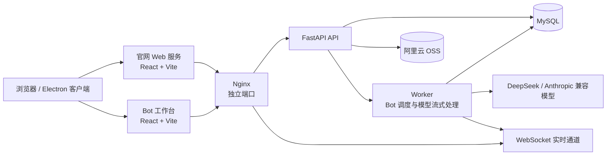

# 同频 AI

同频 AI 是一个面向团队的多 Bot 协作聊天平台。团队成员可以在同一个聊天室里发送任务、上传资料、@指定 Bot，并让不同角色的 Bot 按顺序协作完成分析、计算、检索和文档生成。项目同时提供官网、Web 工作台、Windows Electron 客户端和 FastAPI 服务端。

## 产品背景

在合同审阅、产品讨论、交易计算和资料整理等场景中，信息通常散落在聊天、附件和多个工具里。单个智能助手难以同时覆盖业务理解、产品分析和技术执行，团队也很难追踪任务上下文、工具调用过程与最终产物。

同频 AI 将聊天室作为协作入口，将 Bot 配置、成员权限、附件知识和任务结果统一保存。用户可以按角色创建 Bot，在消息中使用 `@Bot` 选择参与者；系统保存完整消息链路，并通过实时事件让成员看到 Bot 的生成状态和工具执行结果。

## 核心功能

- **账户与工作空间**：注册、登录、刷新会话、退出登录和跨页面恢复登录状态。
- **聊天室协作**：创建、重命名和归档聊天室，查看成员，保存消息和协作记录。
- **成员邀请**：按邮箱发送邀请；接收方通过邀请中心查看未读邀请、查看邀请人和聊天室名称，并直接加入聊天室。
- **Bot 管理**：创建 Bot，配置名称、描述、系统提示词和工具权限；编辑版本、启用或停用，并加入或移出聊天室。
- **多 Bot 调度**：一条消息可以按明确的 `@Bot` 顺序触发多个 Bot，后续 Bot 可读取前序结果并继续处理。
- **实时消息**：通过 WebSocket 推送新消息、Bot 状态、工具事件和邀请提醒；断线后按序回放事件。
- **附件处理**：支持 PDF、DOCX、TXT、Markdown、PNG 和 JPG；上传前校验大小，服务端进行权限检查、文本提取和预览签名。
- **工具与产物**：支持附件读取、计算器和 Markdown/DOCX/PDF 生成；工具调用过程和生成文件会显示在聊天记录中。
- **桌面端**：Electron 主进程、Preload 和 Renderer 分离，提供受限 IPC、原生选文件和保存文件能力。

## 系统架构



### 运行时职责

- **官网**负责产品介绍、功能说明和入口跳转。
- **工作台**负责登录后的聊天室、Bot 管理、邀请中心、附件预览和协作记录。
- **FastAPI**负责认证、权限、聊天室、消息、邀请、附件和 Bot 配置等业务接口。
- **Worker**负责消费任务、调用模型、执行工具、写入流式结果并发布实时事件。
- **MySQL**保存用户、聊天室、成员、Bot、消息、邀请、附件和事件数据。
- **OSS**保存受权限控制的附件和生成文件，访问采用短时签名 URL。

## 部署端口

生产环境使用两个独立的 Web 服务：

| 服务 | 地址 | 用途 |
| --- | --- | --- |
| 官网 | `http://122.51.39.141:18083/` | 产品官网 |
| BOT 工作台 | `http://122.51.39.141:18082/` | 登录、聊天室和 Bot 协作 |

两个端口共享 API、Worker、MySQL 和 OSS，但前端容器、Nginx 配置和入口页面彼此独立。端口由服务器 `.env` 中的 `WEBSITE_PORT` 和 `BOT_PORT` 控制；部署时请确认没有占用现有系统服务端口。

## 目录结构

```text
.
├─ apps/
│  ├─ website/          # 官网 React/Vite 入口
│  ├─ workbench/        # 连接真实 API 的 BOT 工作台入口
│  └─ desktop/          # Electron 主进程、Preload 和桌面入口
├─ backend/
│  ├─ app/              # FastAPI 路由、模型、服务和 Worker
│  ├─ alembic/           # 数据库迁移
│  └─ tests/             # 后端测试与联调测试
├─ packages/
│  ├─ contracts/         # 前后端共享的数据契约
│  └─ workbench/         # UI 组件、演示数据和公共静态资源
├─ deploy/
│  ├─ compose.yml        # MySQL、迁移、API、Worker、官网和 BOT 服务
│  ├─ Dockerfile.backend # 后端镜像
│  ├─ Dockerfile.frontend# 双前端镜像
│  ├─ nginx.conf         # 官网入口配置
│  └─ nginx-bot.conf     # BOT 工作台入口配置
├─ docs/                 # 实施方案、验收差距和设计说明
├─ scripts/              # 桌面端配置和辅助脚本
├─ tests/                # 前端 Vitest 测试
├─ package.json          # Node 工作区和构建脚本
└─ .env.example          # 环境变量模板
```

## 本地开发

### 前端

```powershell
npm ci
npm run website:dev       # http://127.0.0.1:5173
npm run workbench:dev     # http://127.0.0.1:5174
```

生产构建：

```powershell
npm run build
```

构建产物位于 `dist/website` 和 `dist/workbench`。运行 UI 测试：

```powershell
npm run test:ui
```

### 后端

先将根目录 `.env.example` 复制为 `.env`，填写至少 40 个字符的 `JWT_SECRET` 和模型、OSS 配置：

```powershell
cd backend
python -m venv .venv
.\.venv\Scripts\python.exe -m pip install -e '.[test]'
.\.venv\Scripts\python.exe -m alembic upgrade head
.\.venv\Scripts\python.exe -m uvicorn app.main:app --reload --host 127.0.0.1 --port 8000
```

另开终端启动任务 Worker：

```powershell
.\.venv\Scripts\python.exe -m app.worker
```

API 文档地址为 `http://127.0.0.1:8000/docs`。开发环境可以使用 SQLite；使用 MySQL 时将 `DATABASE_URL` 配置为 `mysql+asyncmy` 地址。

## Docker 部署

```bash
cp .env.example .env
# 设置数据库密码、JWT_SECRET、模型和 OSS 凭据
docker compose -f deploy/compose.yml --env-file .env up -d --build
```

部署前至少配置：`APP_ORIGIN`、`JWT_SECRET`、`MYSQL_PASSWORD`、`MYSQL_ROOT_PASSWORD`、模型凭据、OSS 凭据、`WEBSITE_PORT` 和 `BOT_PORT`。生产环境应在前置反向代理上启用 HTTPS，设置安全 Cookie，配置 OSS CORS，并建立数据库备份和日志策略。

## 安全与配置原则

- 模型、数据库和 OSS 凭据只通过后端环境变量注入，不使用 `VITE_` 前缀暴露到浏览器。
- 附件访问先做成员权限校验，再返回短时签名 URL；原始文件不由 API 代理下载。
- WebSocket 会校验来源和一次性实时票据，邀请使用一次性令牌和未读计数。
- `.env`、数据库文件、上传缓存、构建产物和桌面签名证书不提交到 Git。

## 测试与验收

后端测试：

```powershell
cd backend
.\.venv\Scripts\python.exe -m pytest
```

前端测试和构建：

```powershell
npm run test:ui
npm run build
```

涉及真实模型或 OSS 的联调脚本会产生外部服务请求和临时对象，运行前请确认当前环境变量和费用预算。生产上线前还应补充 TLS、备份、监控、限流和安装包签名验收。

## 许可证与状态

当前仓库用于同频 AI 产品开发和部署验证。详细实施记录与未完成项见 `docs/实施方案.md` 和 `docs/验收差距.md`。

