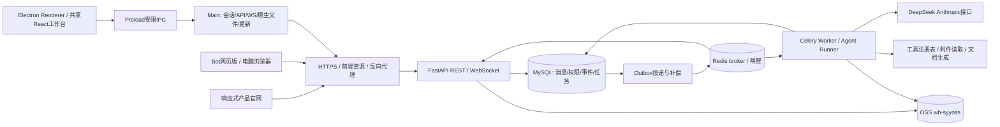

# 同频 AI：响应式官网与 Bot 网页版 / Electron 桌面端完整实施方案

版本：2026-10-22。状态：待实施的产品与技术设计，不代表系统已经开发、部署或外部服务已经联通。

## 1. 项目目标与交付范围

按选定的第一套蓝白方案，完成两个相互衔接、可独立访问的前端系统：

1. **产品官网**：完整介绍产品、展示实际协作场景，引导进入工作台；覆盖桌面和移动端。
2. **Bot 协作系统（网页版 + Electron 桌面端）**：两端共享React工作台与FastAPI后端，支持多人进入同一聊天室、创建与添加Bot、通过 `@Bot` 发起任务、受控工具调用及有限协作，并保存消息、执行记录和产物。网页直接访问；桌面首版交付Windows x64安装包。

首版优先保证核心闭环，不引入支付、积分商城、插件市场、复杂工作流画布或可视化 Agent 编排。适配范围以本版为准：**Bot支持电脑浏览器和Electron桌面端；官网完整适配电脑、平板和手机；Bot手机端不作为首版完整业务交付。** 两个Bot端共享界面、协议和服务器数据，通过平台适配器实现浏览器/原生能力差异。FastAPI、worker、数据库、模型调用与OSS签名都在服务器。

### 1.1 核心使用场景

小林创建“产品发布讨论”聊天室，邀请同事，加入“策划助手”和“文案助手”；输入 `@策划助手 @文案助手 整理发布计划，并输出一份公告文案`。策划助手先调用工具并生成计划，文案助手基于该结果继续完成公告。所有成员实时看到执行状态、工具摘要、最终结果和文件；刷新或重新加入后仍能查看。

### 1.2 用户已指定的技术与配置

| 项目 | 确定方案 |
|---|---|
| 视觉 | 第一套清爽蓝白：白底、蓝色主操作、灰色分隔、少阴影 |
| 前端 | React + TypeScript + Vite；shadcn/ui + Ant Design；Lucide 图标；官网与网页工作台独立构建、共享组件 |
| Bot桌面端 | Electron，Main/Preload/Renderer分层；共享React工作台，Windows x64首发 |
| 后端 | Python + FastAPI + Pydantic + SQLAlchemy + Alembic |
| 数据库 | MySQL 8，utf8mb4，UTC 存储时间 |
| 实时同步 | REST 提交操作 + WebSocket 统一订阅房间事件 |
| 异步执行 | Celery worker + Redis broker；数据库 Outbox 补偿投递 |
| 模型 | DeepSeek Anthropic-compatible API；配置名保留 `deepseek-v4-flash` |
| 文件 | 私有 OSS Bucket `wh-syyoss`，北京地域 |
| 发布 | Docker Compose：web（官网+工作台静态资源）、api、worker、mysql、redis；HTTPS/WSS同源访问 |
| 桌面发布 | 独立打包签名安装包及更新源，不把后端密钥或数据库打进客户端 |

密钥仅通过后端环境或部署密钥服务注入。本文和示例文件不包含用户提供的真实 Token、AccessKey Secret，不将它们写入前端、Git、原型或日志。正式联调使用轮换后的凭据。

## 2. 两套 UI 库如何协作

### 2.1 组件职责

| 范围 | 组件来源 | 规则 |
|---|---|---|
| 官网、导航、聊天消息、输入区、轻量弹层 | shadcn/ui | Button、Dialog、Sheet、Popover、Command、Avatar、Tooltip、ScrollArea |
| Bot 编辑、邀请成员、复杂表单、管理表格 | Ant Design | Form、Select、Table、Upload；不在同一流程重复使用两种 Dialog |
| 所有业务图标 | Lucide React | 统一 18/20px、strokeWidth=1.75，图标按钮有 aria-label |
| 主题 | CSS token + Ant Design ConfigProvider | 一套颜色/圆角/间距映射，不维护两套视觉规范 |
| 数据与状态 | TanStack Query + Zustand | Query 管服务器状态；Zustand 仅管侧栏、当前房间和 UI 临时状态 |

建立 `ui/` 原子组件、`ui-admin/` 表单包装和业务组件三层，业务页面只通过包装组件使用弹层与通知；统一 z-index、焦点恢复和 toast。聊天/官网不加载管理页重型组件，按路由拆包。

Ant Design 与 Tailwind 使用明确 CSS layer 顺序，防止 reset 互相覆盖；只设置一份全局 reset。实施时按所选 Ant Design/Tailwind 版本的官方兼容配置验证弹层、Input 和按钮状态。[Ant Design 样式兼容说明](https://ant.design/docs/react/compatible-style/)

### 2.2 基础视觉规格

```text
primary        #2563EB    主按钮、链接、选中态
primary-hover  #1D4ED8
text           #0F172A    正文主色
text-muted     #64748B    时间、说明
border         #E2E8F0
surface        #F8FAFC    侧栏/浅色消息背景
success        #16A34A    仅用于已保存/已完成
danger         #DC2626    删除、失败
radius         8px；不做大圆角卡片堆叠
spacing        4/8/12/16/24/32/48
font           系统无衬线 + 中文系统字体；正文 14–16px
desktop button 36px；主要表单操作 40px；手机点击区域至少 44px
```

Bot工作台同时交付电脑浏览器和Electron窗口版本，优先验收1024/1280/1440/1920px宽度。1440px下房间栏约240px、成员/Bot栏约260px，中间聊天自适应、正文上限约800px；小于1200px先收起右栏，避免挤压输入框。官网完整适配320/360/390/768/1024/1440px；320px不横向溢出，手机按钮点击区域至少44px。原型中的手机聊天图仅作为后续参考，本次不要求Bot移动端达到完整业务适配。

## 3. 页面结构与路由

| 路由 | 页面 | 进入方式 |
|---|---|---|
| `/` | 官网：首页、功能、三步上手、页脚 | 对外公开 |
| `/guide` | 简短使用指南 | 官网及帮助入口 |
| `/login`、`/register` | 登录、注册 | 进入工作台前 |
| `/invite/:token` | 邀请确认 | 邀请链接，登录后返回原页 |
| `/app` | 最近房间或首次引导 | 登录后 |
| `/app/rooms/:id` | 聊天室 | 房间列表/通知 |
| `/app/bots` | 我的 Bot、工作空间可用 Bot | 左侧 Bot 管理 |
| `/app/bots/new`、`/app/bots/:id/edit` | Bot 创建/编辑 | Bot 管理 |
| `/app/records` | 聊天与协作记录 | 左侧历史入口 |
| `/app/settings/members` | 工作空间成员 | 头像菜单，管理员可见 |

首版不额外设计独立“数据大屏”。身份菜单只保留个人信息、工作空间成员、退出登录。访问无权限房间显示“该聊天室不存在或你已无权访问”，不泄露名称和成员。

所有路由均为HTTPS网页地址，支持直接访问、刷新和前进后退；邀请链接也是普通HTTPS链接。官网与工作台同域部署，后端通过/api/v1代理；两份前端构建的路由分发规则见第20节。

上述为Web路由；Electron使用本地受限资源协议 `app://ui` 加载同一工作台构建，并采用Hash路由或等价本地路由映射。`tongpin://` 仅负责外部唤起，不替代网页版本，也不把任意外部页面加载到有Preload的窗口。

## 4. 官网完整交互

1. 导航“功能”“如何使用”滚动至对应锚点，移动端收进菜单；菜单点击后关闭，键盘可操作。
2. Hero使用原型中的“让团队与 AI，在同一个聊天室协作。”，电脑端主按钮“创建第一个聊天室”：已登录进入网页创建流程，未登录进入/login并带站内returnTo。手机端主按钮“查看演示”，旁边保留“登录网页版”入口；进入工作台前明确“完整协作功能建议在电脑浏览器使用”，不伪装手机业务已全部适配。
3. “查看演示”打开轻量演示弹层，展示固定示例对话和工具调用过程；必须标“演示内容”，不发真实模型请求、不伪装成多人在线。
4. 下面只展示三项功能：`@Bot`、工具过程透明、记录留存，以及“创建 Bot → 建立聊天室 → 开始协作”。各 CTA 使用同一登录后落点。
5. 页脚保留真实指南、隐私说明和联系方式；未提供公司信息不得编造客户、销量、好评或备案号。
6. 首屏图片使用优化后的真实应用预览，延迟加载下方媒体；尊重 reduced-motion，无大面积持续动画。

## 5. 工作台逐项交互规范

### 5.1 身份与首次进入

- 邮箱+密码注册/登录；前端基础校验，后端最终校验。错误保留邮箱，不回显密码，不提示可枚举的详细登录原因。
- 注册创建个人工作空间；邀请注册则加入邀请指定工作空间，不在未确认时自动公开资料。
- 无房间时只展示“新建聊天室”主操作及“添加一个 Bot”的三步引导。
- 登录成功恢复合法站内 returnTo；禁止任意外部 URL 跳转。
- 网页Access token保存在内存，refresh session使用HttpOnly、Secure、SameSite Cookie；refresh/logout等Cookie操作校验CSRF与Origin。刷新页面通过安全会话恢复，不把refresh token写localStorage。
- Electron会话由Main托管：access token仅Main内存持有，refresh token使用系统安全存储；Preload不向Renderer暴露令牌。桌面端使用独立会话传输，复用服务端身份/权限逻辑，详见第20节。
- 多个请求同时 401 时仅允许一次 refresh（single-flight）；重放一次仍失败则退出，清理房间订阅和 Query 缓存。

### 5.2 创建与管理 Bot

| 字段 | UI 与约束 |
|---|---|
| 名称 | 必填 2–30 字；同工作空间、同所有者去重提示 |
| 头像 | 首版用 Lucide + 预设底色，不要求用户上传 |
| 简介 | 可选，最多 100 字，展示在 `@` 列表 |
| 角色指令 | 必填，最多 8000 字；提供策划/文案模板；模板可编辑 |
| 工具权限 | 仅勾选服务端公布的工具；默认不开启高风险工具 |
| 可见范围 | 仅自己 / 工作空间；限制谁能添加到房间 |
| 模型 | 后端固定 DeepSeek，界面只显示名称，不让用户输入 API Key |

保存按钮在合法且变更后可用；提交中禁用防重复；失败保留输入。离开未保存页面提示保留或放弃。保存创建不可变 BotVersion，进行中的 run 使用原版本，修改只影响新任务。

“测试 Bot”使用最近一次保存版本、明确的短测试输入和较小 token 预算，计入个人配额；有未保存更改时提供“保存并测试”。测试run的kind为BOT_TEST、room_id为空，只能由发起人读取；UI短时轮询run状态和最终输出，不另造房间或为测试增加第二套流协议。测试对话不写进正式房间，可看到工具是否启用、失败原因和耗时，不显示系统密钥。

Bot 列表提供搜索、创建、编辑、复制、停用；停用后不能新加入或新发起任务，历史结果保留。删除先采用软删除；被房间引用时提示影响，不级联抹掉聊天记录。只有所有者/授权管理员能编辑；工作空间可见不等于人人可编辑。

### 5.3 创建房间、邀请与成员

创建对话框只含名称（2–50字）、可选说明、添加 Bot（最多 5 个）。创建成功进入新房间；失败留在弹层。普通房间消息可多人同时发送，Bot 根任务按房间串行执行。

“邀请成员”可选择已存在的工作空间成员，或生成指定邮箱的单次邀请链接。邀请有效期建议 24 小时；登录后确认加入。链接保存哈希而非原始 token；过期、撤销、已使用分别提供清晰提示。邀请可撤销，不展示外部成员的邮箱搜索结果。

成员面板含头像、名称、房间角色及 Bot 列表；在线仅表示有近期连接/心跳，不能作为身份或授权依据。离开房间前确认；最后一个房主必须先转让或归档。移除成员实时撤销订阅和后续下载权限，取消其排队任务；进行中任务重新校验发起人权限。

### 5.4 聊天输入、`@Bot` 与消息

| 动作 | 期望行为 |
|---|---|
| 输入 `@` | 输入框附近出现房间内启用 Bot 列表；支持搜索、↑↓选择、Enter 确认、Esc 关闭 |
| 选择 Bot | 以不可歧义的 mention 实体保存 bot_id；名称只是展示，不靠正则字符串决定权限 |
| 多 Bot | 按 mention 顺序串行协作，最多 3 个参与同一根任务；发送前显示参与者 |
| 不 `@Bot` | 仅发送多人聊天消息，不自动让所有 Bot 响应；房间可选一个默认 Bot，需明确开关，默认关闭 |
| Enter | 桌面发送；Shift+Enter 换行；中文输入法 composition 时不触发发送 |
| 窄屏访问 | 给出建议电脑使用的轻提示，不强制跳转；本版不承诺完整手机聊天适配 |
| 空消息 | 没有正文和附件时禁用发送；仅附件可发送，AI 分析仍需明确提问或默认提示确认 |
| 乐观消息 | 显示发送中；REST 失败保留并提供重试；使用 client_message_id 去重 |
| 发送后 | 清空已成功提交的内容；服务端接受后才从本地待发送队列移除 |
| 编辑 | 首版只编辑草稿；已发送内容不可原地修改，可复制/补充说明，避免执行依据被修改 |
| 生成中输入 | 人仍能发消息；新 Bot 任务排队，有排位；不偷偷把后发内容注入当前任务 |

输入限制建议 10000 字/条、5 个附件/条；超限在输入区提示。文本按 Markdown 渲染但默认禁用原始 HTML；链接只允许安全 scheme，外链添加 noopener。

消息 actions：复制、引用回复、查看来源/工具详情；失败的 Bot 回复有“重试此任务”，创建新的 run 并关联原 run，不覆写失败记录。向上滚动阅读历史时不强制拉回底部，显示“有新消息”；停留底部才随增量输出滚动。

### 5.5 Bot 回复和协作状态

```text
根任务：QUEUED → RUNNING → SUCCEEDED / FAILED / EXPIRED
取消路径：QUEUED / RUNNING → CANCELLING → CANCELLED
Bot步骤：QUEUED → THINKING → STREAMING → TOOL_RUNNING → STREAMING → COMPLETED
```

“THINKING”仅代表正在处理，不展示模型内部思维链。流式输出按短时间片合并到 UI，避免每字符触发全列表重渲染。未收到正文前显示小型状态行，不放大面积骨架。

工具调用以可展开行展示：工具名、执行中/完成/失败、输入摘要、耗时、输出摘要与产物；敏感参数脱敏。折叠默认不打断正文阅读。工具失败可以在限定次数内重试；无法恢复时 Bot 明确说明缺失能力，不伪造“已搜索”。

协作展示为“文案助手 · 接续 策划助手”，可展开对应步骤。最后一个 Bot 汇总总体结果，房间只保留必要的中间产出，不刷屏显示每个内部 token 或重复总结。

“停止”仅停止对应 run；停止事件确认前显示“正在停止”，后端取消上游请求并拒绝后续旧 worker 写入。浏览器关闭、切换房间、WS 断线都不等同于取消后台任务。

### 5.6 附件、预览与产物

- 首版上传 PDF、DOCX、TXT、MD、PNG、JPG；默认 20MB/文件，单次最多 5 个。DOCX/PDF/TXT/MD 提取正文；扫描 PDF/图片默认可预览，OCR 未启用时明确“暂不支持文字提取”，不承诺上传即识别。
- 文件选择后显示待上传、进度百分比、重试、移除；完成后显示可解析/解析中/失败。上传不等于消息已经发送。
- 不阻塞用户发送“只附文件”的消息；但 AI 读取未 READY 的附件时需等候并有状态提示/超时，不能把空正文传给模型假装分析完成。
- PDF 用 PDF.js；文本/Markdown 用安全渲染；DOCX 首版提供提取文本预览和下载；图片支持适屏、放大。解析隔离运行，限制页数/解压后大小和时间。
- 文件预览只加载当前页/可见页，canvas 根据 DPR 渲染且设置上限；用户关闭弹层后清理 Blob URL 和 worker 任务。
- 生成文件首版支持 Markdown、DOCX、PDF。只有实际写入 OSS 并落库成功才显示可下载文件卡片；无引用也可生成，不制造伪链接。

### 5.7 聊天与协作记录

历史页按房间、时间范围和关键词查询；聊天消息与执行记录分两个轻量标签，不做复杂仪表盘。点击记录定位原消息，工具详情与产物可追溯到对应 run。消息分页使用游标，不用深 OFFSET；归档房间默认只读。

刷新恢复最近房间、草稿及已接受任务；草稿按 user_id+room_id 隔离，登出清理。数据库是历史事实源，localStorage/IndexedDB 不能替代服务端保存。

### 5.8 全局异常与无障碍

初次加载骨架、无内容引导、请求失败重试分别设计。WS 断开显示不遮挡内容的提示条；网络恢复自动补事件，不能出现“本地显示发送成功、服务器没有消息”。401 走续期，403 撤销房间视图，404 回列表，429 展示重试时间，模型错误只影响对应 run。

按钮 loading、禁用原因、焦点边框、表单错误关联、弹层焦点锁定和关闭后焦点恢复统一处理；键盘能创建房间、选择 mention、发送和关闭弹层。

## 6. 后端架构与模块



目录建议：

```text
tongpin-ai/
  apps/website/src/{pages,components,styles}
  apps/workbench/src/{pages,features,components,lib,styles}
  apps/desktop/{main,preload,build}/
  packages/workbench/           # 网页和Electron共同使用的业务页面/状态
  packages/platform/           # browser/desktop transport与文件能力适配器
  packages/ui/                  # 蓝白主题、shadcn包装、Ant Design主题
  packages/contracts/           # API与WebSocket事件schema
  backend/app/
    api/{auth,workspaces,rooms,bots,messages,runs,files,realtime}.py
    core/{settings,security,permissions,errors,logging}.py
    db/{models,session,migrations}/
    services/{messages,uploads,invitations,event_store,outbox}.py
    agents/{runner,scheduler,context,deepseek_adapter}.py
    tools/{registry,calculator,read_attachment,generate_document,handoff}.py
    workers/{tasks,dispatcher,recovery}.py
  tests/{unit,integration,e2e}/
  deploy/{compose.yaml,nginx.conf}/
  .env.example
  README.md
```

采用单代码库模块化单体，worker 与 API 独立进程。API/WS 使用异步 SQLAlchemy 驱动；对象存储同步 SDK、DOCX/PDF 解析不阻塞事件循环，放入线程池或 worker。禁止在 HTTP 请求里等待十分钟模型完成。

## 7. 数据模型、约束与索引

所有业务表含 `id`、`workspace_id`、`created_at`、`updated_at`（UTC）。状态采用固定枚举；ID 使用 UUID/ULID，但不可猜测 ID 不替代权限检查。

| 表 | 主要字段与约束 |
|---|---|
| users | email唯一、password_hash、status；密码 Argon2id |
| sessions | user_id、refresh_hash唯一、expires_at、revoked_at、family_id |
| workspaces | name、owner_id、storage_limit、run_limit |
| workspace_members | UNIQUE(workspace_id,user_id)、role=OWNER/ADMIN/MEMBER |
| rooms | name、created_by、status、next_event_seq、next_message_seq、active_run_id、revision |
| room_members | UNIQUE(room_id,user_id)、role=OWNER/MEMBER/VIEWER、joined_at、last_read_seq |
| invitations | room_id、email、token_hash唯一、expires_at、used_at、revoked_at |
| bots | owner_id、name、visibility、enabled、current_version_id、deleted_at |
| bot_versions | UNIQUE(bot_id,version)、prompt、tool_allowlist、model_name、limits |
| room_bots | UNIQUE(room_id,bot_id)、enabled、added_by |
| messages | UNIQUE(room_id,message_seq)、UNIQUE(room_id,sender_id,client_message_id)、sender_type、body、status、reply_to、run_id |
| message_mentions | message_id、bot_id、position；结构化保存mention |
| message_attachments | message_id、file_id；关联时验证文件归属 |
| runs | kind=ROOM/BOT_TEST、room_id可空、actor_id、source_message_id、input_cutoff_seq、status、snapshot、lease_until、fence_token、cancel_requested_at、retry_of |
| run_steps | UNIQUE(run_id,step_no)、bot_version_id、status、parent_step_id、input/output摘要、usage、error |
| tool_calls | step_id、provider_tool_id、name、safe_args、status、idempotency_key唯一、result_file_id、error |
| files | uploader_id、room_id可空、object_key唯一、size、mime、etag、sha256、upload_state、parse_state、expires_at |
| artifacts | run_id、step_id、file_id、filename、format；产物记录 |
| room_events | UNIQUE(room_id,seq)、type、payload、run_id、created_at；持久化事件 |
| outbox | kind、entity_id、dedupe_key唯一、state、next_retry_at、attempts、lease_until |
| audit_logs | actor、action、resource_type/id、trace_id、脱敏detail |

关键索引：`messages(room_id,message_seq)`，`room_events(room_id,seq)`，`runs(room_id,status,created_at)`，`outbox(state,next_retry_at)`，`files(workspace_id,upload_state,created_at)`。成员查询索引含 user_id。核心关联建立外键或明确应用级完整性规则；软删除不破坏已有 run 的版本引用。

消息正文、模型步骤、工具结果分开保存。大文件正文/产物写 OSS，数据库只存必要文本及索引；模型密钥不放 BotVersion。Run snapshot 固定 BotVersion、模型配置、工具权限和消息截止位置。

## 8. API 契约

API 前缀 `/api/v1`；成功 `{"data":...,"request_id":"..."}`；错误 `{"error":{"code":"...","message":"...","details":{...}},"request_id":"..."}`，真实 HTTP 状态码不全部包成 200。

| 方法 | 路径 | 功能 / 关键规则 |
|---|---|---|
| POST | `/auth/register`、`/auth/login` | 创建身份/登录，限流 |
| POST | `/auth/refresh`、`/auth/logout` | 浏览器Cookie会话刷新/撤销，CSRF校验 |
| POST | `/desktop/auth/login`、`/desktop/auth/refresh`、`/desktop/auth/logout` | Main调用的桌面会话端点，复用身份校验和原子刷新逻辑 |
| GET | `/me` | 用户、工作空间和权限摘要 |
| GET/POST | `/workspaces/{wid}/rooms` | 房间列表/创建，只列有权限内容 |
| GET/PATCH | `/rooms/{rid}` | 房间信息/编辑；PATCH带revision |
| POST | `/rooms/{rid}/archive`、`/rooms/{rid}/leave` | 归档、离开，幂等 |
| GET/POST/DELETE | `/rooms/{rid}/members[/{uid}]` | 成员列表、添加、移除 |
| POST | `/rooms/{rid}/invitations` | 创建邀请；可撤销 |
| POST | `/invitations/accept` | body携带邀请token，不打印日志 |
| GET/POST | `/bots` | 列出可访问Bot/创建 |
| GET/PATCH | `/bots/{bid}` | 读取/版本化保存；revision冲突409 |
| POST | `/bots/{bid}/test-runs` | 已保存版本测试，独立限额；通过run状态接口查询 |
| POST/DELETE | `/rooms/{rid}/bots[/{bid}]` | 加入/移除Bot；校验可见性 |
| GET | `/rooms/{rid}/messages?before_seq=&limit=50` | 历史游标分页 |
| POST | `/rooms/{rid}/messages` | 人类消息落库，必要时创建run，202 |
| GET | `/rooms/{rid}/bootstrap` | 消息、活跃run、权限与snapshot_seq一致快照 |
| GET | `/rooms/{rid}/events?after_seq=` | 断线补偿/诊断，限制页大小 |
| POST | `/rooms/{rid}/read-position` | 服务端单调更新已读游标 |
| GET | `/runs/{run_id}` | 状态、步骤、产物与错误 |
| POST | `/runs/{run_id}/cancel`、`/runs/{run_id}/retry` | 幂等停止 / 新建重试run |
| POST | `/uploads/init` | 创建受限上传会话，返回浏览器OSS直传签名字段 |
| POST | `/uploads/{file_id}/complete` | HEAD确认+校验后提交解析 |
| GET | `/files/{fid}/access?mode=preview|download` | 权限校验后短效访问方式 |
| GET | `/records?room_id=&q=&before=` | 聊天与任务记录 |
| POST | `/realtime/tickets` | 签发一次性WS票据，30秒有效 |
| WS | `/realtime` | 首帧认证，订阅/增量事件/心跳 |
| GET | `/health/live`、`/health/ready` | 存活、DB/Redis等就绪检查 |

发送消息示例：

```json
{
  "client_message_id": "client-generated-uuid",
  "text": "整理发布计划，再撰写公告文案",
  "mentions": [{"bot_id":"bot_planner","position":0},{"bot_id":"bot_writer","position":1}],
  "attachment_ids": ["file_123"],
  "reply_to": null
}
```

返回 `message_id/message_seq/run_id/run_status`；同一 client_message_id、同一内容重试返回原结果，内容不同返回409。服务端从身份和路由推导 workspace，不相信客户端传入的 user_id/workspace_id。JSON合法不等于Bot有工具权限。

## 9. 实时协议与持久化

### 9.1 为什么首版用 REST + WebSocket

REST 负责可靠提交与权限错误；WebSocket 负责房间广播、流式文本、成员变化、任务状态。页面用一条WS复用订阅，不为每个Bot再开一条SSE，避免重复协议和重复事件处理。上游模型仍使用 Anthropic 流协议，由后端转成统一业务事件。

每个工作台标签页由统一RealtimeProvider持有一条WebSocket并复用房间订阅；组件卸载清理监听，避免重复连接。页面刷新先恢复会话和bootstrap，再按seq订阅；多标签页通过服务端消息ID/幂等键去重，不假设浏览器后台标签始终活跃。

Electron中由Main持有同类WS连接，Preload转发统一RoomEvent；React业务组件只依赖RealtimeAdapter，不另外实现一套事件消费规则。两端同时登录同一房间时接收同一服务端序列。

WS先连接，5秒内发送一次性ticket认证；ticket由登录态REST签发，使用一次后删除。认证成功才能订阅指定房间，不能仅凭room_id订阅。长期token和ticket都不放URL。网关校验Origin并限制未认证连接。

```json
{"type":"subscribe","room_id":"room_1","after_seq":128}
```

服务端消息统一：

```json
{
  "v":1,"room_id":"room_1","seq":129,"type":"message.delta",
  "run_id":"run_1","message_id":"message_bot_1",
  "data":{"append":"首先明确发布目标"},"created_at":"2026-10-22T02:00:00Z"
}
```

事件类型：`message.created`、`message.delta`、`message.completed`、`run.queued/started/completed/failed/cancelled`、`tool.started/completed/failed`、`artifact.created`、`member.changed`、`access.revoked`。瞬时在线/typing/heartbeat不写持久事件表，不消耗持久seq。

### 9.2 顺序与恢复

同一房间事件采用严格递增seq：短事务锁住房间counter行，分配序号、写消息/任务变化和room_events，再提交。锁不跨模型网络请求；同房间序号分配和提交由同一锁串行，避免自增ID提交乱序造成游标漏读。事务提交后才发布Redis轻量唤醒。

模型delta按约100–200ms批量持久化并广播；同一事务将message.body更新为当前完整已提交前缀、状态更新为STREAMING，保证bootstrap在生成中也能恢复已有正文。最终message.completed带完整正文以修复增量误差。前端按room_id+seq去重，正文以message_id关联；不能按到达顺序直接拼接所有Bot文本。

初始bootstrap使用一致性读返回snapshot_seq和消息/run快照；随后订阅after_seq补事件。服务端订阅Redis唤醒后主动补查DB，并周期补查，Redis丢通知不会丢业务事件。重连采用指数退避+抖动，恢复游标；成员权限在订阅和周期性续检时复核。

delta事件建议保留7天，完整消息与执行记录按工作空间策略保存。旧游标超期返回 `RESYNC_REQUIRED`，前端重新bootstrap，不能继续假装完整回放。慢消费者队列有上限，积压时关闭并要求游标恢复；历史正文不因队列溢出被丢弃。

Redis不是可靠业务存储；WS写成功也不是用户已读。已读位置由REST显式单调更新。连接每20秒心跳，服务端识别断线；关闭浏览器后后台run继续。

## 10. 多 Bot 编排与工具循环

### 10.1 简单可控的协作规则

不用首版全自动多Agent自由群聊。采用“用户指定参与Bot + 服务端有限调度”：

1. 用户明确mention决定参与者，按顺序执行；最多3个Bot/根任务。
2. 每个Bot可调用允许工具；同一根任务最多12个模型步骤、8次普通工具调用，总预算600秒。
3. 提供 `handoff_to_bot` 工具，仅能移交到本run已授权参与者；移交深度最多2，已执行Bot不反复循环，交接计入全局步骤预算。
4. 策划助手结果作为文案助手上下文；每次Bot输出都有归属和步骤记录。最后一个Bot负责最终汇总。
5. 同房间仅一个根run运行，其余排队，默认队列上限10。人类消息仍可发；排队run启动时按创建时的input_cutoff_seq构造输入，不意外读取后发消息。
6. 服务端读取消息、BotVersion和权限；用户文本/模型输出不能直接指定任意服务端类名、文件路径或下一租户。

### 10.2 首版工具

| 工具 | 能力 | 边界 |
|---|---|---|
| `calculator` | 安全计算，金额使用Decimal | AST/专用表达式解析，不用eval |
| `read_attachment` | 按file_id读取授权附件提取文本 | READY状态，限制长度，检查房间/工作空间授权 |
| `generate_document` | 将正文渲染MD/DOCX/PDF，保存OSS | 文件成功落库后才返回artifact_id |
| `handoff_to_bot` | 有限协作移交 | 参与白名单、步骤/深度/预算限制 |
| `web_search`（可选） | 通过配置的搜索适配器查询 | 未配置供应商/权限时不出现在tools定义；不假装模型自带联网 |

无须第三方搜索Key也能验证工具闭环：上传TXT → read_attachment → calculator → generate_document → 第二Bot总结。首版不提供任意Shell、任意SQL或任意HTTP工具。

### 10.3 工具调用执行细节

Anthropic适配器收集完整 `tool_use` 内容块和JSON参数增量后，校验schema；按原始 `tool_use_id` 生成 `tool_result` 并传回后续请求。保留完整必要content blocks与role顺序，不把工具结果拼成无来源的普通助手消息。UI只展示可公开摘要。

工具权限 = BotVersion允许 ∩ 发起用户当前权限 ∩ 房间可访问范围 ∩ 系统工具白名单。每次执行都重新检查，模型说“已授权”无效。独立只读工具可受控并行，默认最多2；文档生成和移交按顺序执行。

工具幂等键绑定run_id/step_id/tool_use_id；文档文件键使用预分配artifact_id。结果写库与状态变化需原子处理；外部副作用结果未知时标UNKNOWN，不盲目自动重试。消息投递/模型调用无法承诺跨外部服务exactly-once。

## 11. DeepSeek 接入与超时策略

### 11.1 配置映射

用户给出的 `ANTHROPIC_DEFAULT_OPUS_MODEL`、`SONNET`、`HAIKU`、`CLAUDE_CODE_SUBAGENT_MODEL` 是开发工具模型映射配置，不会自动创建本项目的多Bot执行器。应用只读取自己的Settings，Bot协作由第10节Runner实现。

```python
# 接入示意：实际项目补Settings、生命周期管理、错误与usage记录
import anthropic
import httpx

client = anthropic.AsyncAnthropic(
    base_url=settings.anthropic_base_url,
    api_key=settings.anthropic_auth_token,  # 读取用户命名的环境变量，SDK发送x-api-key
    timeout=httpx.Timeout(connect=10, read=60, write=30, pool=10),
    max_retries=0,  # 重试由Runner统一控制，避免SDK与任务双重重试
)

async with client.messages.stream(
    model=settings.anthropic_model,
    max_tokens=4096,
    system=server_built_system_prompt,
    messages=authorized_history,
    tools=authorized_tool_schemas,
) as stream:
    async for event in stream:
        await normalize_and_persist(event)
```

`ANTHROPIC_AUTH_TOKEN` 在应用内显式读取并映射到SDK的api_key参数，使用官方兼容说明支持的x-api-key头；不假设SDK会自动读取所有Claude Code配置。实施阶段做最小鉴权请求测试，不同时发送两套认证头。

当前官方说明：Anthropic-compatible base URL为 `https://api.deepseek.com/anthropic`；`deepseek-v4-flash` 作为旧名称仍接受，但已路由到更新的Flash服务。因此保留用户配置名，不承诺锁定历史模型权重；记录请求模型、响应模型、usage与接入测试结果。[DeepSeek接入说明](https://api-docs.deepseek.com/quick_start/agent_integrations/)、[Anthropic兼容说明](https://api-docs.deepseek.com/guides/anthropic_api/)

### 11.2 上下文与任务预算

- 每个run冻结参与Bot版本、源消息、附件和消息截止seq。
- 首版取最近消息窗口，按实际模型token计数或保守预算截断；工具输出和附件提取文本有独立上限。不能只按消息数量无限传全部历史。
- 保留当前问题、引用消息、附件摘要和前序Bot结果；溢出时先裁减旧闲聊/冗长工具输出。原始历史仍在DB/OSS，压缩不改原文。
- 后续可以加入带source_seq范围的摘要，但本版不因新增摘要引入复杂向量库或RAG检索服务。
- 输出token上限、根任务token成本预算、用户并发/每小时配额分别限制，避免600秒内无限调用。

### 11.3 600000ms不等于所有超时都设置600秒

根run硬截止600秒；SDK连接10秒、单次读取空闲60秒、工具通常30秒，文档解析单独60秒预算；所有子步骤不得超过根剩余时长。用统一deadline传递，不能每换一个Bot再增加600秒。

429/连接失败等仅在未产生可见正文、未执行副作用且仍有预算时最多重试2次，遵守Retry-After并加抖动。已输出部分正文后失败，保留PARTIAL并标记失败，用户明确重试生成新run；不自动重复追加两份答案。

## 12. OSS 文件完整方案

### 12.1 已确定配置

```dotenv
OSS_BUCKET=wh-syyoss
OSS_REGION=cn-beijing
OSS_ENDPOINT=https://oss-cn-beijing.aliyuncs.com
OSS_PUBLIC_HOST=https://wh-syyoss.oss-cn-beijing.aliyuncs.com
OSS_ACCESS_KEY_ID=<由后端部署密钥注入>
OSS_ACCESS_KEY_SECRET=<由后端部署密钥注入>
```

`PUBLIC_HOST` 只表示外网访问域名，不代表Bucket应设为公共读。Bucket维持private，HTTPS访问，RAM限制到业务前缀和必要操作。正式环境优先绑定RAM角色/临时凭据；已有RAM长期密钥仅在服务端使用，不进入浏览器。

### 12.2 首版上传路径

选用服务端签名的PostObject直传：后端返回短期签名表单及策略，浏览器直接上传，不让大文件经过API服务器。PostPolicy限制精确key、短有效期与20MB大小；签名通过官方SDK/实现封装，不自行拼容易出错的算法。若后续支持大文件分片，再引入受限STS及分片方案。[OSS直传授权方式](https://help.aliyun.com/en/oss/developer-reference/authorize-access-6)、[PostObject说明](https://help.aliyun.com/zh/oss/developer-reference/postobject)

```text
选择文件
→ POST uploads/init（认证、配额预占、生成file_id和唯一key）
→ 返回5分钟有效签名策略
→ 浏览器XHR上传到OSS（有进度、abort）
→ POST uploads/{id}/complete
→ 后端HEAD确认大小/对象key/归属与元信息
→ 文件内容校验/提取文本worker
→ files.READY与room事件
```

网页使用input[type=file]或拖拽得到浏览器File对象，通过XHR直传获得进度和abort能力；签名由登录态后端获取，前端不取得OSS长期secret。预览/下载按浏览器安全机制实现，不需要本地文件系统特权。

Electron上传由Main原生选文件、登记opaque handle并流式上传同一签名表单；Renderer只取得必要文件元信息。产物下载通过原生保存对话框和授权artifact_id完成，不能通过IPC传任意路径/URL获取本地权限。

object_key为 `tongpin/{workspace_id}/uploads/{file_id}/source.ext`；产物为 `tongpin/{workspace_id}/artifacts/{artifact_id}/result.ext`。原文件名只存在元信息，不参与可控目录拼接。上传ID、workspace、room和uploader在init时固定，complete不能替换对象key。

每个上传会话只完成一次；签名过期只重签同一未完成会话，避免重复预占。HEAD验证不等于恶意内容校验，MIME使用声明值+实际magic/解析检测；ETag不当作通用SHA-256。需要内容哈希时由可信后端计算。最终文件类型不允许直接作为可执行HTML同源展示。

### 12.3 失败与补偿

上传成功但complete失败：重新调用complete幂等确认；上传中断可重试；未完成会话24小时过期，定时清理对应孤儿对象和释放配额。对象清理只依据受控记录/前缀，不按用户传路径删除。

首版不依赖OSS callback才能成功，避免公网回调接入复杂度。后续启用回调时验证签名并快速落库，解析排队异步执行；OSS官方说明回调失败不会自动重试，因此仍保留complete/后台对账。[OSS上传回调](https://help.aliyun.com/zh/oss/developer-reference/callback/)

### 12.4 预览、下载和跨域

`files/access`检查当前成员与文件归属，再给60秒短效签名URL或受控代理流。URL过期时客户端重新请求；签名URL有剩余有效期期间可能继续可用，严格即时撤权的房间改走鉴权代理，不宣称URL已立即撤销。

Bucket CORS只允许真实站点和本地开发源，允许实际使用的POST/GET/HEAD；暴露必要ETag、Content-Range等头供客户端读取。签名URL、查询参数、长期密钥不进入日志。下载设置安全Content-Disposition；预览域尽量与应用隔离。

## 13. 权限与安全边界

工作空间角色 OWNER/ADMIN/MEMBER；房间角色 OWNER/MEMBER/VIEWER。房间VIEWER只读，MEMBER可发消息和触发已授权Bot，OWNER管理房间成员/Bot/归档。工作空间ADMIN可管理工作空间成员与公共Bot，但不会默认读取未加入的私密房间内容；确需审计访问时单独授权并留痕。

所有REST、WS订阅、事件回放、工具读取、下载、历史查询均校验workspace+room成员。Bot创建者权限不自动赋予调用人，工具以当前发起人最小权限执行。模型不能扩大可见范围。

密码Argon2id；refresh token哈希存储并原子轮换，检测重复使用；账号禁用撤销会话。模型密钥和OSS secret仅服务端，日志采用字段白名单；错误不返回原始异常/请求头。输入prompt、附件和网页均不可信，禁止模型指令绕过工具授权。

加入基础保护：登录/邀请/发送/run分别限流；附件容量预占与并发配额；严格上传校验；工具URL获取禁止内网/metadata地址并逐跳验证；Markdown禁用原始HTML。跨租户、跨房间IDOR、XSS、CSRF和邀请滥用作为验收用例，而非只做UI测试。

## 14. 并发、一致性与异常恢复

### 14.1 发送消息事务

认证授权 → 锁定必要房间状态 → 按client_message_id查重 → 插入message/mentions/attachments → 创建run及outbox → 写room_events → 一次commit。提交后唤醒WS；任何网络发布失败都不会删除已提交消息。

同key不同内容409；并发重复提交由唯一约束兜底，冲突后读取已有结果。房间修改revision采用 `UPDATE ... WHERE revision=:expected` 检查affected rows，不做只在Python中先查再比的伪乐观锁。

### 14.2 Worker任务领取

Outbox dispatcher独立定期扫描PENDING/到期重试事件，用短租约领取，投递成功标记；投递成功但回写失败会重复投递，消费者必须幂等。Celery启用late ACK等可靠消费选项，Redis broker可见性超时建议大于最长run（例如1800秒），不把broker配置当成exactly-once保证。

同房间运行权由DB的active_run_id和run状态条件更新保证，不只靠Redis锁。run租约60秒、每10秒续约，fence_token递增；所有worker进度写入检查当前fence，旧进程恢复后不能继续写过期run。恢复扫描器处理租约到期任务和过期队列。

对于已产生部分正文但失去worker的run，首版run标FAILED、error_code=WORKER_INTERRUPTED，对应消息保留PARTIAL状态并允许显式重试；不承诺从模型中间token无损续算。文档产物用artifact_id幂等防重复，模型重复调用计费风险如实记录。

### 14.3 统一错误码

`AUTH_EXPIRED`、`ACCESS_REVOKED`、`REVISION_CONFLICT`、`MESSAGE_ID_CONFLICT`、`ROOM_QUEUE_FULL`、`BOT_DISABLED`、`UPLOAD_EXPIRED`、`FILE_NOT_READY`、`MODEL_RATE_LIMITED`、`MODEL_TIMEOUT`、`TOOL_FAILED`、`RUN_CANCELLED`、`RESYNC_REQUIRED`。UI对每类有明确动作：重试、等待、重新授权或返回列表，不只弹“系统异常”。

## 15. 部署与配置

### 15.1 环境变量示例（只含占位符）

```dotenv
APP_ENV=production
APP_ORIGIN=https://<你的域名>
DATABASE_URL=mysql+asyncmy://<user>:<password>@mysql:3306/tongpin
REDIS_URL=redis://redis:6379/0
JWT_SECRET=<部署时生成的随机密钥>
COOKIE_SECURE=true
ANTHROPIC_AUTH_TOKEN=<通过后端密钥注入>
ANTHROPIC_BASE_URL=https://api.deepseek.com/anthropic
ANTHROPIC_MODEL=deepseek-v4-flash
API_TIMEOUT_MS=600000
MAX_RUN_STEPS=12
MAX_TOOL_CALLS=8
MAX_RUN_BOTS=3
MAX_UPLOAD_MB=20
OSS_BUCKET=wh-syyoss
OSS_REGION=cn-beijing
OSS_ENDPOINT=https://oss-cn-beijing.aliyuncs.com
OSS_PUBLIC_HOST=https://wh-syyoss.oss-cn-beijing.aliyuncs.com
OSS_ACCESS_KEY_ID=<服务端注入>
OSS_ACCESS_KEY_SECRET=<服务端注入>
```

Vite前端只接受公开API路径，不定义VITE_*模型key或OSS secret。.env.local、生产secret目录加入.gitignore；提供.env.example和必填项启动校验。缺少外部服务时启动报告能力状态，不悄悄用假回答冒充真实模型。

### 15.2 启动与发布步骤

开发：安装前端锁定依赖、Python虚拟环境与锁定依赖 → 本地MySQL/Redis → Alembic迁移 → 初始化工作空间 → 启API与worker → 启官网与工作台Vite。开发代理统一转发/api/v1与WebSocket；README给出website:dev、workbench:dev及各自build命令。前端不读取服务端secret。

生产：Nginx同域托管官网和Bot工作台两份静态构建，代理/api/v1及WebSocket；配置Upgrade、Origin、TLS、上传策略和心跳。SPA回退不能覆盖API或静态资源404。WS代理空闲超时大于心跳间隔；600秒run由后台worker执行，不让普通HTTP请求等待十分钟。

上线先备份数据库、跑迁移兼容检查、发布API/worker再发布兼容前端；静态文件带hash，入口HTML短缓存。数据库/Redis不向公网暴露。首版建议单API+单worker限制并发，压测后再扩副本；多API共享DB事件和Redis，不能使用进程内房间列表作为唯一广播来源。

## 16. 测试与验收矩阵

| 场景 | 验收结果 |
|---|---|
| 官网桌面/手机 | 导航、锚点、演示、CTA、登录回跳可用，无横向溢出 |
| 两个浏览器/用户同房间 | 人类消息、Bot增量、工具结果一致，刷新后记录保留 |
| 创建/编辑Bot | 真实保存版本；旧run保持原版本，新run使用新版本 |
| mention | 电脑浏览器中文输入法、键盘选择不误发；后端校验bot_id |
| 两Bot协作 | 策划→文案产生接续关系，均有步骤与结果，限制循环 |
| 工具 | 读附件、计算、生成PDF/DOCX/MD闭环；失败可解释 |
| 附件 | 超限/伪类型拒绝；上传进度/取消/重试；complete幂等 |
| 模型联调 | 真实认证、流式正文、tool_use/result、多轮工具、usage、超时与429回退 |
| 断网重连 | 已接受任务继续；按seq补齐不重复；过期游标重新同步 |
| 并发重复发送 | 同client_message_id只落一条消息和一个根run |
| 用户撤权 | REST/WS/工具读取拒绝；下载剩余有效期行为符合设计 |
| worker崩溃 | 租约到期可恢复状态，旧worker写入被fence拒绝 |
| Redis中断 | 聊天事实不丢，DB补偿/Outbox重试；UI提示降级 |
| OSS失败 | 不生成假文件卡片，不把未确认对象标READY |
| 安全 | 跨workspace/room读取失败，前端构建产物无密钥 |

测试层次：工具和权限单元测试；MySQL/Redis真实集成测试验证事务/游标/幂等；Playwright覆盖核心流程与多浏览器同步（实施阶段按用户浏览器验证偏好执行）；移动视口与键盘无障碍检查；模型少量付费联调用例与mock故障用例分开。

工程目标（待实测，不作已达成承诺）：非模型接口p95<500ms；已提交房间消息可见延迟p95<500ms（不含公网异常）；流式UI更新100–200ms批次；首字等待分别统计排队/模型/工具耗时；首轮压测覆盖50并发连接、5并发模型run，再据资源调参。

## 17. 实施顺序与交付物

| 阶段 | 范围 | 退出标准 |
|---|---|---|
| A 产品/基础 | 响应式官网+共享Bot工作台、Electron安全骨架、平台适配器、登录与数据库迁移 | 网页/桌面共用业务页面、权限基础可用 |
| B 多人通信 | 房间/成员/邀请、消息持久化、WS事件/补偿 | 两用户同步及断线恢复通过 |
| C Bot与模型 | Bot版本、Runner、DeepSeek流、有限协作、工具循环 | 真实两Bot任务完成并可追溯 |
| D 文件 | OSS受限直传、验证解析、产物、预览下载 | 上传到生成文件闭环通过 |
| E 发布验收 | 官网移动适配、网页浏览器兼容、Electron安装/签名/更新、故障测试与部署 | 网页、桌面和服务端验收通过，可回滚 |

单人熟悉该全栈与Electron的情况下，网页/桌面共用UI、包含Windows安装与更新验收的首版按约3–4周规划；这是估算，取决于现成模块、签名证书和联调条件。先跑通共享业务闭环，再验证两端适配，避免维护两份业务逻辑。

最终交付：响应式官网源码及构建产物、Bot网页源码及构建产物、FastAPI源码、数据库迁移、.env.example与web.env.example、Docker Compose/Nginx配置、启动/配置README、OpenAPI及WS事件契约、前端交互说明、测试报告和模型/OSS联调记录。真实密钥通过服务端部署配置，不进入仓库或前端。

桌面同时交付Electron Main/Preload源码、共享工作台构建、Windows x64安装包、desktop.env.example、IPC类型契约和升级说明。正式签名依赖受控CI证书；开发测试包不得称为正式签名包。

## 18. 已知外部依赖与明确边界

- 本方案不自动配置或验证用户Bucket、RAM权限、CORS、域名和DeepSeek账户额度；实施联调需真实检查，失败要输出可定位原因。
- 保留用户指定的DeepSeek模型名，但不保证旧别名对应历史权重。模型API兼容性通过真实最小用例验证，不根据Claude Code环境变量推断全部支持能力。
- 网站内容用自有品牌与实际产品能力；未接入的搜索、OCR或实时在线能力不得在UI中伪造。
- 此新项目按独立目录实施，与此前合同审查系统隔离；不修改该系统的生产reranker或既有服务。

## 19. 参考与选定视觉

- [第一套蓝白原型](01-蓝白原型.png)
- [shadcn/ui Vite接入](https://ui.shadcn.com/docs/installation/vite)
- [Ant Design与Tailwind样式层](https://ant.design/docs/react/compatible-style/)
- [DeepSeek Anthropic API](https://api-docs.deepseek.com/guides/anthropic_api/)
- [DeepSeek当前模型名称及旧名称映射](https://api-docs.deepseek.com/quick_start/agent_integrations/)
- [OSS浏览器上传授权方式](https://help.aliyun.com/en/oss/developer-reference/authorize-access-6)
- [OSS PostObject](https://help.aliyun.com/zh/oss/developer-reference/postobject)
- [OSS Callback失败行为](https://help.aliyun.com/zh/oss/developer-reference/callback/)

## 20. 网页 / Electron 双端实施与验收

### 20.1 共享层与平台适配层

共享 `packages/workbench` 中的房间、Bot、成员、历史、任务状态、蓝白主题及React业务组件；共享 `packages/contracts` 的接口/事件schema。通过 `AuthAdapter`、`ApiAdapter`、`RealtimeAdapter`、`FileAdapter`、`NotificationAdapter` 注入环境能力，组件不直接判断平台后复制整套业务。

| 能力 | 网页版 | Electron |
|---|---|---|
| 页面运行 | HTTPS静态资源，浏览器路由 | 安装包内本地资源，共享工作台，受限app://协议 |
| 会话 | access内存 + HttpOnly refresh Cookie | Main内存access + 系统安全存储refresh |
| HTTP/WS | 浏览器统一请求/实时Provider | Main托管，受限Preload桥接 |
| 上传 | File对象 + XHR进度/abort | Main文件handle + 流式上传/IPC进度 |
| 下载 | 授权下载链接/Blob，浏览器保存 | artifact_id授权 + 原生保存对话框 |
| 通知 | 默认应用内提醒；浏览器系统通知可后续启用 | 应用内提醒 + 经用户允许的原生通知 |
| 发布 | 静态构建、HTML短缓存、资源hash | 签名安装包、版本更新和重启恢复 |

两端同步依赖服务端的持久化数据，不能用本地缓存互相替代。退出/切换用户清理当前端的会话和缓存；提供显式“退出所有设备”撤销其他会话，避免误把单端登出当全端退出。

### 20.2 官网移动适配与网页部署

官网桌面使用原型Hero左右布局，手机纵向排版；导航折叠菜单、CTA易点击、预览图保持比例。手机主CTA可用“查看演示”，辅入口为“登录网页版”；提示Bot完整协作建议电脑使用。电脑同时提供“在线使用”和“下载桌面版”，两者均可达核心功能，不强制安装。

同域Nginx分发：`/`、`/guide`使用website构建；`/login`、`/register`、`/invite/*`和`/app/*`使用workbench构建；各构建资源使用独立前缀防冲突；`/api/v1/*`和WebSocket先匹配代理，API/资源404不得回退成HTML。官网和网页工作台均可独立刷新。客户端更新/下载使用独立受控路由，不占用业务SPA路径。

### 20.3 Electron进程安全

- Main：窗口生命周期、会话、HTTPS/WSS、原生文件、通知和升级；不加载模型/OSS长期密钥，不在主线程执行重型文档解析。
- Preload：通过contextBridge一方法一能力暴露类型化API；不暴露ipcRenderer、通用invoke、任意fetch、fs或shell。
- Renderer：共享React工作台，只处理UI和用户交互，`nodeIntegration=false`、`contextIsolation=true`、`sandbox=true`、`webSecurity=true`；不读取refresh token。

生产加载app://ui受限静态资源，处理器限制固定目录并防路径穿越；开发仅允许明确的本地Vite地址。配置CSP、拒绝不需要的permission request、拦截任意导航/window.open，验证外链后交系统浏览器。不能关闭webSecurity来绕过请求限制。[Electron上下文隔离](https://www.electronjs.org/docs/latest/tutorial/context-isolation/)、[安全建议](https://www.electronjs.org/docs/latest/tutorial/security/)

IPC示例能力包括 `auth.login/restore/logout`、`rooms.sendMessage/subscribe`、`files.choose/upload/saveArtifact`、`runs.cancel` 和只传业务payload的onRoomEvent。Main校验发送方frame/webContents与允许来源、参数schema、会话及handle归属，后端继续最终授权。回调返回unsubscribe，窗口卸载或用户切换后释放监听。

### 20.4 桌面会话与原生文件

Main调用desktop会话端点，refresh token由系统安全存储加密保存；根据所选Electron版本使用相应safeStorage接口，安全存储不可用时禁用“记住登录”，不回退明文。桌面应用属于public client，不使用安装包内共享secret证明身份。[safeStorage说明](https://www.electronjs.org/docs/latest/api/safe-storage)

文件由原生对话框选取，在Main保存路径并生成绑定当前用户/窗口的opaque handle，Renderer仅看到名称/大小。上传只读取受控handle；产物保存由用户选择目的路径、后端artifact_id鉴权，下载临时文件完成后原子更名。既不暴露任意本地读写，也不把大型Buffer反复通过IPC传输。网页和桌面仍共享OSS init/complete、文件状态和解析worker。

### 20.5 窗口与运行交互

首版单主窗口，默认1280×840、最小960×640；优先原生标题栏；保存窗口状态前校验显示器工作区。启用单实例锁，二次启动聚焦已有窗口。关闭窗口默认退出，可选留在托盘必须显式开启；上传未完成时提示，服务端Bot任务继续。

休眠/唤醒重建连接并按seq补事件，不能重新提交已接受的任务。网页刷新和桌面重启都使用服务端bootstrap恢复房间/任务，草稿按用户+房间隔离。离线提供只读缓存和草稿，不展示未经服务器确认的“发送成功”。

支持 `tongpin://rooms/new`、`tongpin://rooms/{id}` 与短效邀请code唤起；白名单解析路由，禁任意命令/路径/远程HTML。深链不含长期token，仍需登录及服务端授权。官网保留网页入口，唤起失败提供下载/在线使用选项。[Electron深链](https://www.electronjs.org/docs/latest/tutorial/launch-app-from-url-in-another-app)

### 20.6 打包与更新

Windows x64首版采用electron-builder/NSIS及配套electron-updater，固定工具版本；正式包代码签名并验证安装包完整性。更新制品存OSS独立releases前缀，经HTTPS受控分发，不将业务Bucket整体设公共读。更新元数据需在所有制品上传完成后发布，并校验平台/架构/渠道。

Main检查/下载更新，签名或完整性失败则拒绝安装；下载不阻塞聊天，提示“重启后更新”。有本地未保存/上传内容时提醒处理，服务端任务继续；升级失败保留旧版本与数据。macOS另列签名、公证、安装和更新验收，不把Windows交付当macOS已支持。[Electron更新机制](https://www.electronjs.org/docs/latest/tutorial/updates)

### 20.7 双端补充验收

| 场景 | 标准 |
|---|---|
| 官网手机 | 320/360/390px导航、Hero、演示、入口可用，无横向溢出 |
| Bot网页 | 1024–1920px核心任务可用，Chrome/Edge当前主流版本兼容 |
| Electron | 安装、首次登录、重启恢复、窗口缩放/多屏、单实例正常 |
| Web与桌面同房间 | 消息/工具/产物和run最终状态一致，无重复任务 |
| IPC | 未授权来源/channel/路径拒绝，Renderer无法访问secret |
| 文件与系统 | 原生上传/下载取消重试、通知、睡眠唤醒不损坏记录 |
| 更新 | 错误签名拒绝、失败保留旧版、重启恢复任务和草稿 |

客户端公开配置仅包含API/官网/更新地址和APP_ID；DeepSeek、OSS、JWT和数据库密钥只在服务端。桌面配置见desktop.env.example，网页只需API路径配置见web.env.example。

